# 𖤝 ReAnimation - first-person - v3: Complete
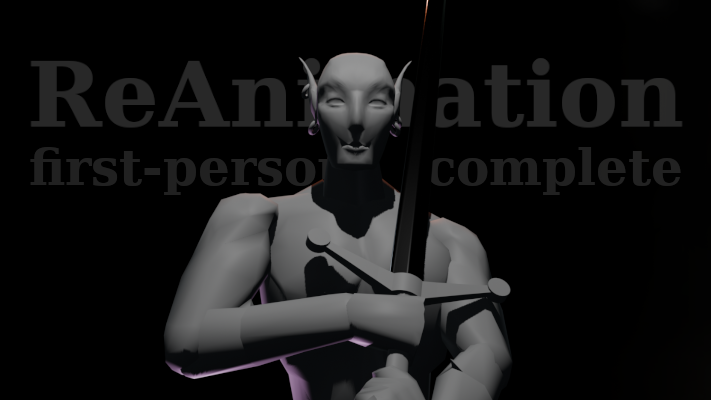

An immersive reimagining of the TES3: Morrowind 1st-person animations. Punch, slash, chop, shoot and _thrust_ your way through vvardenfell with style! 

Absolute most animations are remade from scratch and many more animations are added to break up the repetative attack animation spam. Furthermore some weapon subtypes received few additional unique animations (shortblades and katanas).

Overall twice as much animation juice as the original game.

Does not include spellcasting animations.

Developed for OpenMW engine. **Requires OpenMW 0.51+**.

## 𖤝 Check out my cool donation banner

I also have a cool donation banner now:

<p><a href="https://ko-fi.com/maxyari">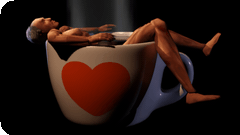</a><a href="https://ko-fi.com/maxyari">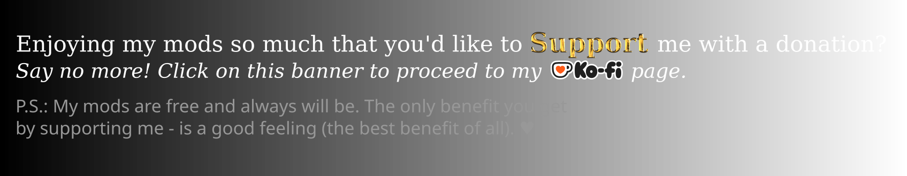</a><br><a href="https://ko-fi.com/maxyari">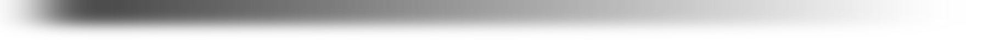</a></p>

Thank you for being around, and have fun :) 

## 𖤝 Appreciation

Thanks to [fallchildren](https://github.com/fallchildren2) for code contributions and motivating me to expose a (somewhat) proper API.

Thanks to [taitechnic](https://forums.nexusmods.com/profile/193965921-taitechnic/) and [S3ctor](https://github.com/magicaldave) for the code contribution and optimisation help.

My thanks go to OpenMW discord community for massively helping me overcome a multitude of Lua hurdles, testing and providing feedback, with a special thanks to [SPITSFIRE](https://www.nexusmods.com/profile/SPITSPHIRE/mods) for discovering and investigating a number of v3 issues.

Thanks to [MrArrean](https://www.nexusmods.com/profile/MrArrean/mods) for annoyingly critical attitude that helped me to improve some of the animation feel (❤) 

## 𖤝 A lot of gifs

That show _some_ of the animations. (Give them some time to load)

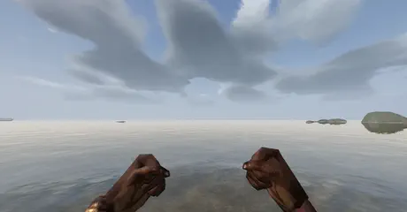
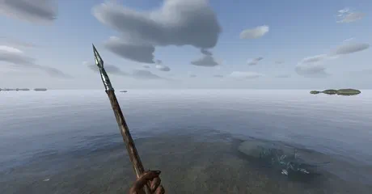
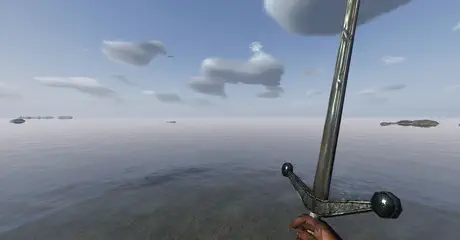
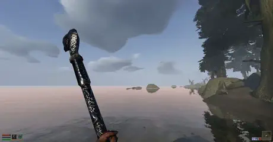
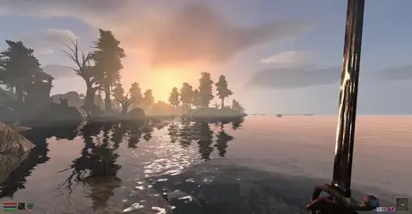
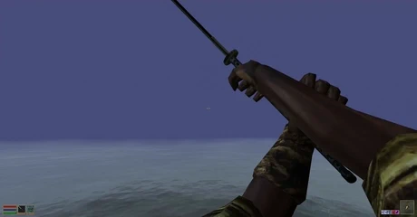
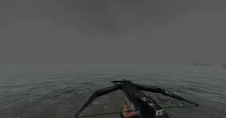
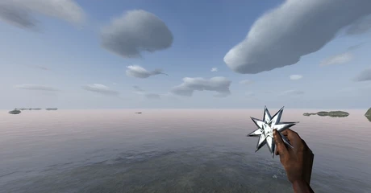


## 𖤝 How to install

**Requires OpenMW 0.51+**

1) Install the dependency [Max Yari's Script Services (MSS)](https://www.nexusmods.com/morrowind/mods/60256) (Most of my lua mods require it now)

2) Install this mod. It comes with a FOMOD installer, so **with a mod organiser** it should work seamlessly: drag and drop the mod archive into your mod organiser of choice (e.g [Mod Organizer 2](https://github.com/ModOrganizer2/modorganizer/releases) on Windows or [Nerevarine Organizer](https://github.com/grazelandsnomad/nerevarine_organizer/releases/tag/v0.70) on Linux), and the installer explains the optional patches.\
   **To install manually** ([this tutorial](https://modding-openmw.com/tips/installing-mods/) explains how, using the launcher or by hand, it's very easy): install the contents of the `00 Core` folder, that is the mod. The other numbered folders are patches, which you only need if you use the corresponding other mods: Full Body Awareness, and Improved Thrown Weapon Projectiles with its patches (see Mod compatibility below). Add the ones you need after `00 Core`.\
   **Updating a manual install of an older version**: the mod now lives in `00 Core`, so point your data folder there, and remove the old version's files instead of extracting over them.

3) Enable the mod's .omwscript files in "Content Files" tab of the OpenMW launcher ( `ReAnimation_API` and `ReAnimation_v3` at the time of writing). 

4) OpenMW Launcher -> Settings -> Visuals -> Animations: "Use Additional Animation Sources" and "Smooth Animation Transitions" must be enabled!

5) _VERY OPTIONAL_: Setting your view-model (1st-person model) field of view to a higher value makes the first person experience a bit more exciting, note this is not the same as field of view in game settings, you can find how to change it in this [reddit post](https://www.reddit.com/r/OpenMW/comments/1i2dl4r/anyway_to_change_viewmodel_fov/). Try a value of 75 or 70.

6) ... ???

7) PROFIT (Play)

*NOTE #0*: If you want to use this with [Full Body Awareness](https://www.nexusmods.com/morrowind/mods/56625) now theres a compatibility patch, an option in the installer, read below in Mod Compatibility section for details.

*NOTE #1*: In Morrowind Mod Organiser you might see a dialog box with a "The contents of `<data files>` does not look valid" error, this is fine and expected, Mod Organiser is just not aware of how additional animations work in OpenMW, you can safely press OK without changing anything.

*NOTE #2*: OpenMW camera 1st person head-bob (the one that can be enabled in scripts in-game) may slightly conflict with the walk cycle animation, it's not too bad, but the mod was developed assuming that setting is turned off.

*NOTE #3*: If you _only_ want to use ReAnimation as an API  for another mod (i.e only as a dependency that doesnt add any animations on its own) - only enable `ReAnimation_API` AND delete "Animations" folder from within this mod's `00 Core`. MSS is still required.

### Performance

This mod was optimised to hell and back and quite likely will have a 0 performance impact in your setup, but if you are running a Lua-heavy modlist (with or without this mod) and experiencing occasional stutters - install [RubicOn Lua optimiser](https://www.nexusmods.com/morrowind/mods/58557) - usually it just magically solves all Lua-related performance issues.

## 𖤝 Mod suggestions

[Full Body Awareness](https://www.nexusmods.com/morrowind/mods/56625) to see your own body in first person. Supported through an installer option (together with FBA's First Person Hands patch), see Mod compatibility below.

[Dynamic Camera](https://www.nexusmods.com/morrowind/mods/55327) for more dynamic first person camera and visual effects. "Trust me bro" its not some annoying head bob - its subtle, tasteful and makes the experience feel more polished. Also an update for Dynamic Camera is in the works that will further improve [Full Body Awareness](https://www.nexusmods.com/morrowind/mods/56625) experience.

[Dynamic Reticle](https://www.nexusmods.com/morrowind/mods/56584) mostly for hit markers to make hits (especially marksman ones) more impactfull.

If you would like NPCs to also have alternating attack animations - try [3rd Person Alt Attacks](https://modding-openmw.com/mods/3rd-person-alt-attacks/) by [fallchildren](https://github.com/fallchildren2) (These animations are made in a different style and dont exactly match mine, but you might enjoy them)


## 𖤝 Mod compatibility

**[Full Body Awareness](https://www.nexusmods.com/morrowind/mods/56625) (FBA)** is supported through **FBA Compatibility**, an option in this mod's installer (the `01 FBA Compatibility` folder): ReAnimation's animations merged with FBA's, so your legs and body move with them. It also requires FBA's **First Person Hands** patch, from [FBA's mod page](https://www.nexusmods.com/morrowind/mods/56625?tab=files): it puts the 1st-person hands back and adapts FBA's own animations to them.

Load order: FBA -> FBA's First Person Hands -> ReAnimation (installed by hand: `00 Core`, then `01 FBA Compatibility`), and enable the First Person Hands plugin after FBA's.

To merge other animation mods with FBA, or rebuild with different settings, use the script in this mod's archive (the installer doesn't install it): `Sources/Tools/FBACompat/build_compat.py` (see its [README](Sources/Tools/FBACompat/README.md)).

**[Improved Thrown Weapon Projectiles](https://www.nexusmods.com/morrowind/mods/44763)** makes thrown weapons fly point first and spin, but in OpenMW its knives and stars turn 90 degrees in your hand while you throw or draw them. This mod's installer has a fix for it (it also flies the stars flat and spins everything faster), with fixed versions of its patches for Iron Mesh Improvements, Improved Weapon Meshes (Steel, Ebony, Organic) and Glass Glowset. Install Improved Thrown Weapon Projectiles itself, but none of those thrown weapon patches: neither its own nor Improved Weapon Meshes - Organic's. **ReAnimation has to load after Improved Thrown Weapon Projectiles**, and after the weapon mesh mods you picked patches for: they all ship their own, unfixed, copies of these meshes. Details in the [thrown fix's README](Sources/Tools/ThrownFix/README.md).

In general Reanimation is compatible with practically any other animation mod. ReAnimation uses OpenMW system of animation overrides and will only override a specific set of animations. Recommended to use with [MCAR](https://www.nexusmods.com/morrowind/mods/48628) for delightfull swimming and casting animations, but will work just fine without it. MCAR should be situated in a load order before ReAnimation.

[Better Bodies](https://www.nexusmods.com/morrowind/mods/48387) (while not wearing shoulder armor) and maybe other body replacers, as well as some custom modded shoulder armors or full body armors - all display a sharp protruding polygon at on the left side of the screen while sneaking with a dagger. This seem to be more of an asset issue and/or a general messed up way how sneak works under the hood (by essentially dislocating character's neck). _I THINK_ (I havent tested it myself because im lazy) using [Smooth first-person Sneak for OpenMW](https://www.nexusmods.com/morrowind/mods/55241) should completely fix the issue.

## 𖤝 Vanilla/MWSE compatibility

Only v1 version of this mod (far fewer animations in comparison to v3, no alternating attacks e.t.c) is available for vanilla Morrowind, you can find v1 in the downloads section on nexus.

v3 is not currently compatible. If you would like to port the scripting part to MWSE - please do, I'm not familiar with MWSE and am not planning to change that.
However, if possible - keep this mod as a dependency, instead of reuploading the whole thing.

## 𖤝 For Modders

ReAnimation exposes an API (an interface for other mods to use): alternating and substitute attack animations for different weapons, attack "tails" that let an attack animation end as long and smoothly as you want, and generic conditional animation overrides. All of it is documented in the [git repository](https://github.com/MaxYari/OpenMWReAnimation#basics). If you are already reading this on git - just read below.

<!-- nexus-skip-start -->
Let me preface this by saying that the text below is 75% human written but then never properly proof-read or checked for spelling, and the rest of 25% is AI slop-generated. Nevertheless it should contain all the information you might need, sorry if its too annoying to read :)

### Basics

ReAnimation exposes an API (Interface for other mods to use). The interface works around some of the OpenMW Lua animation API limitations and provides a simple way of adding alternating attack animations for different weapons, as well as a slightly less simple way of defining generic conditional animation overrides.

To ensure that the ReAnimation interface is available, your mod should either be loaded after the ReAnimation API, or you should interact with the interface from inside the update function instead of the global scope. But in the latter case, ensure that you register your animations/overrides only once, and not every update tick.

#### Attack variants

Is a way to register alternating ("alt" below) and substitute ("sub" below) attack animations. Alternating attadcks play in alternating (duh) fashion, while sub attacks are a random replacement of an attack animation. As a simple example - you might have 2 variants of a downward chop animations and 1 variant of upward swing, you want downchop to always be followerd by up swing, but you also want a random chop to be used every time for your down chop. In this example your chop variants are sub attacks while your upward swing is an alt attack. Below example setups exactly this kind of scenario for two-handed chops.

```Lua
local I = require('openmw.interfaces')

I.ReAnimation.addAttackVariants({
    id = "MyTwoHandAttacks",                  -- optional, for removeAnimationOverride
    parentAttackGroupname = "weapontwohand",
    armatureType = I.ReAnimation.ARMATURE_TYPE.FirstPerson,
    subAttackMode = I.ReAnimation.SUB_ATTACK_MODE.Random,  -- or RoundRobin
    condition = function() return not I.ReAnimation.isEquippedWeapon("katana") end, -- optional
    attacks = {
        chop   = { { "weapontwohand", "weapontwohandsub" }, { "weapontwohandalt" } },
        slash  = { { "weapontwohand" }, { "weapontwohandalt" } },
        thrust = { { "weapontwohand" }, { "weapontwohandalt" } },
    },
})
```
heare "weapontwohand", "weapontwohandalt" and "weapontwohandsub" are names of animation groups to which your attack animations belong. I.e for chops: vanilla chop is stored in weapontwohand, alt chop is stored in weapontwohandalt group (which i simply made up) and, similarly, sub chop is stored in weapontwohandsub. It IS important that all extra attack animations belong to their own groups distinct in name from the vanilla attack group and each other. It is fine to keep different attack types (chop/slash/thrust) under the same groupname as it is done in the example above.

Here's also an AI slop summary in case I missed something since I dont even want to bother re-reading the things that I wrote above:
- **The outer list alternates.** Attacks of one type step through it in order, so a single step means no alternation. If that attack type isn't used for `sequenceResetTime` seconds (default 3), the sequence starts over from the first step.
- **The inner list holds interchangeable variants.** `subAttackMode` picks one per attack: `Random` (the default; `randomMaxRepeats`, default 3, caps how often the same one comes up in a row, and 0 removes the cap) or `RoundRobin` (in the listed order).
- **Listing the parent group itself plays the vanilla animation**, so vanilla can be one of the options. Attack types you leave out are not touched.
- **`condition` gates the whole set**, e.g. by the equipped weapon (`isEquippedWeapon`, `getEquippedWeaponId`).
- **`overridePriority` ranks sets on one parent** (default 0). While a higher set's condition holds, for an attack type it lists, every lower set on that parent stands down, so a general set needs no condition at all: ReAnimation's katana set sits at 1 above its general two-handed set at 0, and its throwing star set at 1 above the thrown one. Rank yours above ReAnimation's sets on that parent to win over them. Sets of equal priority still need conditions that are never true at the same time.
- **Text key timings must match the parent's exactly** by default, the same as for alt attacks: a variant plays on top of the hidden vanilla attack, whose keys still trigger hits and move the attack through its stages.
- **`timingMatching = I.ReAnimation.TIMING_MATCHING.ToOverride` lifts that**: the variant keeps its own timings, and the hidden parent is sped up or slowed down section by section (wind up, release, follow through) so its keys land on the variant's. Both groups need the same key *names*, only the times may differ. This lets you use animations made for another weapon without re-timing them. The default is `TIMING_MATCHING.None`.
- **`id`** is optional, for `removeAnimationOverride`. Also optional: `stance` (default `STANCE.Weapon`), `randomMaxRepeats` and `sequenceResetTime`.

`addAltAttackAnimations({ parentAttackGroupname = ..., altAttackGroupname = ..., armatureType = ... })` is the older shorthand for one alternating pair on every attack type.

#### Tails

Essentially an extra part of an attack animation that plays after follow stop (if present). It does not affect gameplay and can be interrupted by starting another attack, but it allowes to make the attack animation ending transition as long and as beautiful as you want it.

 ReAnimation looks for a group named `<attack group>extra` with a `<Type> Tail Start` and `<Type> Tail Stop` key, and plays that section if both exist. For example, `weapontwohand`'s chop plays the `Chop Tail Start` to `Chop Tail Stop` section of `weapontwohandextra`. Variant groups get their own, so `weapontwohandsub` uses `weapontwohandsubextra`.

For a seamless transition between the follow stop and tail, it is recommended to bundle this blend rule alongside your .kf file:

```yaml
blending_rules:
  - from: "*:*follow start"
    to: "*:*tail start"
    easing: "linear"
    duration: 0
```

If you dont know what "blend rules" even mean, honestly - don't bother, you probably will not notice that anything is wrong with the transition.

#### Generic conditional animation override:

```Lua
local omwself = require('openmw.self')
local I = require('openmw.interfaces')

I.ReAnimation.addAnimationOverride({
    id = "myDaggerSneakOverride",
    parent = "idle1s",
    groupname = "idle1ssneak",
    armatureType = I.ReAnimation.ARMATURE_TYPE.FirstPerson,
    stance = I.ReAnimation.STANCE.Weapon,
    condition = function(self)
        return omwself.controls.sneak
    end,
    stopCondition = function(self)
        return not self:condition()
    end,
    options = function(self)
        local opts = I.ReAnimation.gutils.cloneAnimOptions(self.parentOptions)
        opts.loops = 999
        opts.priority = self.parentOptions.priority + 1
        return opts
    end,
    startOnUpdate = true
})
```
This registers a special "idle1ssneak" idle animation that will play whenever the vanilla "idle1s" animation is playing AND the character is in sneak mode. 

`parentOptions` and the return value of the `options` method are of the same format as [playBlended options parameter](https://openmw.readthedocs.io/en/latest/reference/lua-scripting/openmw_animation.html#(animation).playBlended). 

The fields:
- `parent`: the group whose plays it overrides, or a list of them (it is then registered once per parent). `nil` for one that only starts on update. Group names are lowercase, as the engine passes them.
- `groupname`: the group it plays.
- `armatureType`: **required**, `ARMATURE_TYPE.FirstPerson`, `ThirdPerson` or `Any`. An override without one never plays.
- `stance`: `STANCE.Weapon` (the default), `Spell`, `Nothing` or `Any`.
- `condition(self)`: true to start. `stopCondition(self)`: true to stop it while it plays. It also stops when its parent stops.
- `startOnAnimEvent`: start when the parent is played (the condition is asked then). `startOnUpdate`: start whenever the condition turns true while the parent plays, or at any time with no parent (asked every frame, so keep it cheap).
- `options(self, parentOptions)`: the playBlended options. Started from the parent's play, it gets the parent's options, which it may also change; started on update it gets `nil`, and `self.parentOptions` holds the ones the parent was last played with.
- `onUpdate(self, dt)`: optional, called every frame while it plays.
- `overridePriority`: optional. Ranked overrides on one parent replace each other: a higher one that plays keeps lower ones from starting, and stops them. Leave it `nil` for an override that layers on top of others.

This is a very raw override method that can barely be considered a properly polished API. It provides a lot of flexibility but also requires some understanding of how the OpenMW animation API functions. The best way to use this method is to pick one of the override definitions from AnimationOverrides.lua as a base for your own.

Added overrides can be removed using 
```Lua
I.ReAnimation.removeAnimationOverride("my_override_id")
```
Where `my_override_id` is an id you provided to the override in `addAnimationOverride` (if you provided such an id at all). One registered with several parents is removed from all of them, and stopped if it is playing.

#### Key-triggered animations

A fire-and-forget animation that starts when a text key fires on its parent group, and is never tracked after that, so it costs nothing per frame:

```Lua
I.ReAnimation.addKeyTriggeredAnimation({
    id = "myTrigger",                       -- optional, for removeKeyTriggeredAnimation
    parent = "weapontwohand",               -- group whose text keys to listen to; may be a list
    key = "*follow stop",                   -- the key, with an optional leading and/or trailing "*"
    groupname = "mygroup",                  -- group to play
    armatureType = I.ReAnimation.ARMATURE_TYPE.FirstPerson, -- optional, defaults to Any
    stance = I.ReAnimation.STANCE.Weapon,   -- optional, defaults to Weapon
    condition = function(self, key) return true end,   -- optional
    preTrigger = function(self, key) end,   -- optional, may change self.groupname or self.enabled
    options = function(self, key)           -- required, the playBlended options
        return { startKey = "start", stopKey = "stop", autoDisable = true }
    end,
})
```

Keys arrive lowercased and without their "groupname: " prefix. `"chop hit"` matches exactly, `"*follow stop"` by suffix, `"chop*"` by prefix, `"*follow*"` anywhere and `"*"` everything. Give the options `autoDisable = true` unless you clean up yourself. `I.ReAnimation.removeKeyTriggeredAnimation(id)` removes one.

#### Equipment helpers

For conditions. They are cached (the engine is asked at most every 0.1 s, through MSS), so polling them every frame is cheap:
- `getEquippedWeapon()` and `getEquippedItem(slot)`: the item, or nil.
- `getEquippedWeaponId()` and `getEquippedItemId(slot)`: its record id, lowercased.
- `isEquippedWeapon(substring)`: true when the weapon's record id contains a lowercase substring.
- `setEquipmentCacheTime(seconds)`: how long a lookup is reused, 0.1 by default, 0 for once per frame. A swap is noticed up to that long after it happens.

An item enchanted in game has a generated record id ("generated:0x..."), so id matching does not see what it was made from. Its record keeps the original mesh, though: ReAnimation's katana and throwing star sets match the record's `model` path as well as the id. Get the record from the item (`types.Weapon.record(item)`), since a generated id only resolves in its original case.

#### Other fields

- `ARMATURE_TYPE`, `STANCE`, `SUB_ATTACK_MODE`, `TIMING_MATCHING`: the enums above.
- `state`: the actor's current `stance` and `armatureType`, and `onStateChange`, an event: `I.ReAnimation.state.onStateChange:addEventHandler(function(state) ... end)` runs when either changes.
- `animations`: every registered override, by parent group. Read it, don't change it.
- `gutils`: helper functions, e.g. `cloneAnimOptions`, `expandPriority`, `uniquifyPriority`, `getArmatureType`.
- `resetPlayingState()`: clears ReAnimation's cache of which groups play, a debugging aid.
- `version`: the API version.

<!-- nexus-skip-end -->

## 𖤝 AI Disclaimer

During v3 development Claude Code was used heavily for essentially automating and simplfying evering around animation production which is not animation production itself: e.g developing scripts, finding info in the OpenMW source code and archives, improving the animation toolset, improving and optimising the API. Despite all the obvious ethical and enviromental concerns that come with AI use, truth be told, without the ability to offload absolute tons of tedium to an AI - I dont think this update would ever been possible.

🤖 Clank clank.


